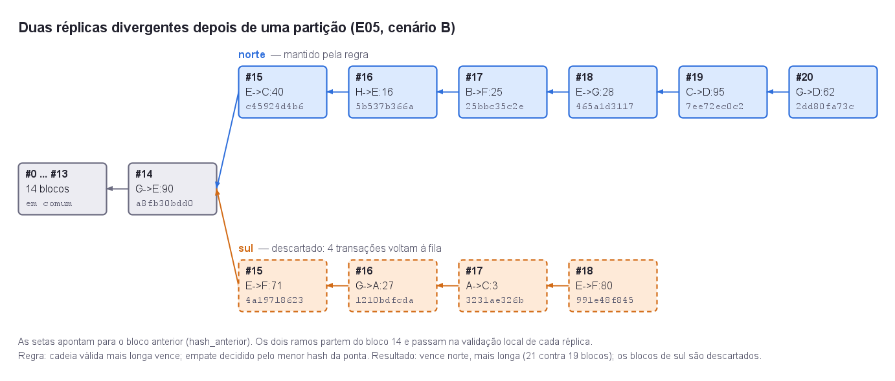

# AP6 — Exploração de integridade, replicação e consenso

Blockchain didática da Atividade Prática 6 de Sistemas Distribuídos, implementada em **Java 21**
com Maven. Parte do código `explorar_cadeia.py` do enunciado e mostra, com experimentos
reproduzíveis, o que o hash resolve (detectar adulteração) e o que ele não resolve (escolher
entre duas cópias válidas que divergem). Essa escolha depende de um protocolo distribuído.

As respostas às questões de análise, o texto "hash não é consenso" e o diagrama estão em
[`Questoes-de-Analise-AP6.docx`](Questoes-de-Analise-AP6.docx).

---

## Execução

Requisitos: JDK 21 ou mais novo e Maven 3.9. Não há dependências externas: o SHA-256 vem do
próprio JDK (`java.security.MessageDigest`).

```powershell
mvn -q compile exec:java
```

Roda os cinco experimentos, imprime os hashes e as verificações no terminal e regrava a pasta
[`evidencias/`](evidencias/). Para rodar só alguns, passe os ids:

```powershell
mvn -q compile exec:java "-Dexec.args=E04 E05"
```

Uma execução parcial só imprime no terminal e **não** altera `evidencias/`. Assim o relatório
nunca fica com parte dos experimentos.

### Conferência com o código do PDF

`referencia/explorar_cadeia.py` é o código do enunciado sem alteração. Os hashes que ele produz
são os mesmos que o E01 compara com o Java:

```powershell
cd referencia
python -c "import runpy; m = runpy.run_path('explorar_cadeia.py'); print(*[b.hash for b in m['cadeia']], sep='\n')"
```

```text
(True, 'cadeia válida')
(False, 'hash inválido no bloco 1')
776ebbe7ffb61b6a4b5fe534692f2334e70a07088209788e1176fc6970483ee4
9bbeddfb50de6294c98d78aad6ea72c02d22720813c4eb94600d498749865972
df5f4d5552ddab026eece0e0507f97897373825ba422d7f2618b577f6e3bdd65
a0a5d1d2f2917cfc2d5c6909efd80897746430ea8116519aae55a1e18d57e40b
```

---

## Experimentos

| Experimento | Manipulação | Resultado principal |
| --- | --- | --- |
| E01 — cadeia didática | cadeia do PDF; depois gênese + 24 transações geradas (semente 2026) | 4/4 hashes e as 2 saídas iguais às do Python; cadeia de referência com 25 blocos, válida |
| E02 — avalanche | `"bloco A"` → `"bloco a"`; último dígito de cada bloco gerado | 1 caractere muda em média 129,0 de 256 bits (50,4%), mínimo 116; mudar o bloco 10 muda os 15 hashes seguintes e nenhum anterior |
| E03 — adulteração | valor trocado para 1000 nos blocos 1, 5, 12 e 23, sem recalcular | `hash inválido` exatamente no bloco alterado; a auditoria não acusa nenhum outro |
| E04 — reescrita | fraude no bloco 5, depois ressela, depois recalcula do 5 ao 24 | o erro vai de `hash inválido no bloco 5` para `ligação inválida no bloco 6` e some; com 20 hashes recalculados a fraude responde `cadeia válida` |
| E05 — réplicas divergentes | prefixo comum de 15 blocos; omissão, partição, empate e réplica bizantina | partição: norte (21 blocos) vence sul (19) e 4 transações voltam à fila; a fraude reescrita com 1 bloco a mais vence a cópia honesta |

**54 verificações, 0 falhas.** Duas execuções, uma delas a partir de `mvn clean`, geram os 8
arquivos de `evidencias/` idênticos byte a byte, inclusive o PNG. Os 25 hashes que o Java grava
em `cadeia-referencia.json` também foram recalculados com a classe `Bloco` do Python original, e
todos coincidem.



| Arquivo em `evidencias/` | Conteúdo |
| --- | --- |
| [`relatorio.md`](evidencias/relatorio.md) | tabela de experimentos (objetivo, manipulação, esperado, obtido) e tabelas detalhadas de cada um |
| `e01.log` … `e05.log` | logs com os hashes completos de cada passo |
| [`cadeia-referencia.json`](evidencias/cadeia-referencia.json) | os 25 blocos da cadeia de referência, para conferência externa |
| [`diagrama-replicas.png`](evidencias/diagrama-replicas.png) | as duas réplicas divergentes do cenário B do E05 |

---

## Arquitetura

Quatro módulos Maven, um por camada. Cada um tem um `module-info.java` que declara de quem
depende e o que expõe, então uma camada de baixo não consegue importar uma de cima: o código
nem compila.

```text
  laboratorio   APLICAÇÃO + APRESENTAÇÃO   experimentos, relatório, diagrama, main
       │
  replicacao    SERVIÇO (várias cadeias)   réplicas, detecção de fork, reconciliação
       │
  integridade   SERVIÇO (uma cadeia)       validar e adulterar
       │
  nucleo        DOMÍNIO                    bloco, cadeia, SHA-256, forma canônica
```

```text
nucleo/          br.sd.ap6.nucleo
  cripto/          Sha256, SerializadorCanonico (= json.dumps(sort_keys=True)), DistanciaDeBits
  dominio/         Bloco (record imutável), Cadeia (imutável)

integridade/     br.sd.ap6.integridade
  validacao/       Validador: validar() para no 1º erro, como o PDF; auditar() lista todos
  adulteracao/     Atacante: alterarDados, resselarBloco, reescreverDesde, fraudar

replicacao/      br.sd.ap6.replicacao
  rede/            Replica (nó com estado), DetectorDeFork, Divergencia
  reconciliacao/   RegraDeReconciliacao (interface), CadeiaMaisLongaVence, Reconciliador

laboratorio/     br.sd.ap6.laboratorio
  ExecutarTodos    main
  geracao/         GeradorDeTransacoes (semente fixa)
  experimentos/    E01 … E05
  relatorio/       RelatorioMarkdown, DiagramaPng (Java2D), EscritorDeEvidencias, SaidaDeConsole

referencia/      explorar_cadeia.py do enunciado, intocado
```

### Decisões de projeto

**Hashes idênticos aos do Python.** O hash é calculado sobre o texto JSON do bloco, então o port
só é fiel se o texto for o mesmo. O `SerializadorCanonico` reproduz o `json.dumps(sort_keys=True)`:
chaves em ordem, separadores `", "` e `": "` e caracteres fora do ASCII escapados como `\uXXXX`.
Por isso a cadeia do PDF dá os mesmos hashes em Java e em Python.

**Adulteração explícita.** `Bloco` e `Cadeia` são imutáveis. Adulterar devolve uma cópia que
mantém o hash antigo (`comDadosAdulterados`), em vez de alterar um campo escondido. A cadeia de
referência fica intacta e todo experimento pode compará-la com a versão fraudada.

**Regra de reconciliação como estratégia.** O `Reconciliador` valida as duas cópias, detecta o
fork e delega a escolha a uma `RegraDeReconciliacao`. A regra proposta é a cadeia válida mais
longa, com empate decidido pelo menor hash da ponta. Trocar por "maior trabalho acumulado" não
mexe no resto.

**Experimentos com verificações.** Cada experimento declara objetivo, manipulação, esperado e
obtido, e registra verificações. O `ExecutarTodos` termina com erro se alguma falhar. Não há
timestamp nem medição de tempo no que é gravado, e é isso que torna as evidências reproduzíveis.

### Limitações do modelo didático

- Não há rede: as réplicas são objetos no mesmo processo e as "mensagens" são chamadas de método.
- Não há assinaturas: qualquer um pode criar `A->B:1000`, e nada prova quem autorizou a transação.
- Não há custo para criar blocos: por isso a regra "mais longa vence" é fraudável (E05, cenário D2).
- Uma transação por bloco, sem Merkle tree, sem mempool real e sem verificação de saldo.
- O `validar()` segue o PDF: confere hash e ligação, mas não confere a sequência dos índices nem a gênese.
